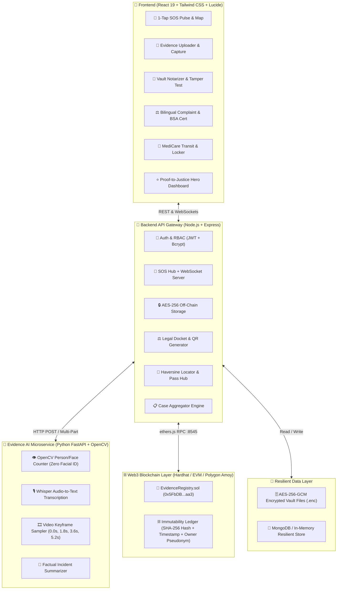
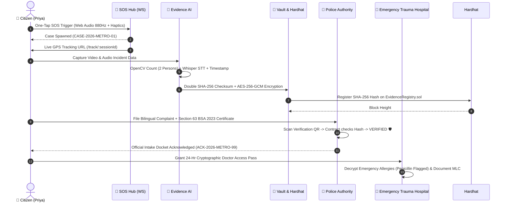

<<<<<<< HEAD
# 🛡️ NIRBHAYA X (निर्भया X)
### *From Safety to Evidence, From Evidence to Justice.*

[](https://opensource.org/licenses/MIT)
[](https://nodejs.org/)
[](https://soliditylang.org/)
[](https://fastapi.tiangolo.com/)
[](https://react.dev/)
[]()

---

## 🌟 Executive Overview

**NIRBHAYA X** is an end-to-end Web3 and Responsible AI platform built to eliminate the fatal bottleneck in women's safety: **the drop-off between immediate physical distress, tamper-proof evidence preservation, legal complaint registration, and emergency medical trauma care.**

In conventional systems, SOS apps trigger emergency contacts or dial police, but when the crisis settles, victims face grueling challenges:
1. Digital evidence (photos, audio recordings, CCTV, metadata) is easily claimed as forged, altered, or unauthenticated in court.
2. Legal filing under India's new criminal codes (**Bharatiya Nyaya Sanhita 2023 [BNS]** and **Bharatiya Sakshya Adhiniyam 2023 [BSA]**) requires stringent Section 63 electronic evidence certification that victims cannot produce alone.
3. Medical documentation of physical trauma (Medico-Legal Cases [MLC]) is disconnected from legal dockets and emergency transit.

**NIRBHAYA X** introduces the unified **Proof-to-Justice Case Journey**: **One Incident = One Unified Case (`CASE-2026-XXXX`)** spanning five interconnected modules:
1. **NIRBHAYA SOS (Protection)**: One-tap instant alert, live WebSocket tracking link, emergency check-in countdown timer, and offline IndexedDB synchronization.
2. **NIRBHAYA EVIDENCE AI (Responsible Analysis)**: Client-side drag-and-drop, pure OpenCV person and face counting (strictly zero biometric identification), Whisper STT audio transcription, video keyframing, and neutral incident summarization.
3. **NIRBHAYA VAULT (Web3 Integrity)**: Dual SHA-256 client/server hashing, authenticated AES-256-GCM off-chain encryption, and on-chain notarization via Ethereum/Polygon smart contracts (`EvidenceRegistry.sol`) with a 1-click byte-tamper demonstration.
4. **NIRBHAYA JUSTICE (Legal Admissibility)**: Bilingual complaint generator (English & Hindi), statutory alignment with BNS 2023, automated Section 63 BSA 2023 / Section 65B IEA Electronic Evidence Certificates, and official police intake receipts (`ACK-2026-XXXX`).
5. **NIRBHAYA MEDICARE (Emergency Care)**: Haversine emergency trauma facility routing, 1-tap ambulance shortcuts (102, 108, 1099, 112), AES-256 encrypted emergency medical locker, and 24-hour cryptographic doctor emergency access passes.

---

## 🏛️ System Architecture



---

## 🔄 Proof-to-Justice Sequence Workflow



---

## 📂 Monorepo Structure

```text
NirbhayaX/
├── package.json               # Root monorepo workspace coordinator
├── package-lock.json
├── .env.example               # Template environment configuration
├── .gitignore
├── scripts/
│   ├── setup.js               # Automated 1-command installer (npm run setup)
│   └── dev.js                 # Unified dev runner orchestrating 4 services
├── contracts/                 # Hardhat Web3 Smart Contract workspace
│   ├── contracts/
│   │   └── EvidenceRegistry.sol  # Solidity smart contract for forensic notarization
│   ├── scripts/
│   │   └── deploy.js          # Hardhat deployment script
│   ├── test/
│   │   └── EvidenceRegistry.test.js  # Smart contract unit tests (3/3 passing)
│   ├── hardhat.config.js
│   └── package.json
├── backend/                   # Node.js + Express API Gateway workspace
│   ├── src/
│   │   ├── config/            # DB, Memory Store fallback & environment
│   │   ├── controllers/       # Auth, SOS, Vault, AI, Justice, MediCare, Case
│   │   ├── middleware/        # JWT auth, RBAC authorization, upload parser
│   │   ├── models/            # User, SOSSession, EvidenceItem, Complaint, MedicalRecord, Case
│   │   ├── routes/            # REST API endpoints
│   │   ├── services/          # Web3 integration, AES cipher, PDF/QR engine, Haversine
│   │   ├── utils/             # Database seeder (seed.js) & logger
│   │   └── server.js          # Express entrypoint + WebSocket HTTP server
│   ├── tests/                 # 8 Automated Test Suites (48/48 passing)
│   ├── vault_storage/         # Encrypted off-chain evidence locker (.enc)
│   └── package.json
├── frontend/                  # React 19 + Tailwind CSS + Vite workspace
│   ├── src/
│   │   ├── components/
│   │   │   ├── common/        # Navbar, Footer, ProtectedRoute, QuickExitModal
│   │   │   ├── sos/           # SOSPulseButton, SafetyCircleManager, FacilitiesMap, etc.
│   │   │   ├── evidence/      # EvidenceUploader, PersonCountCard, AudioTranscriptViewer, etc.
│   │   │   ├── vault/         # EvidenceVault, VerificationCard, TamperDemoModal, AuditTrail
│   │   │   ├── justice/       # ComplaintWizardForm, BilingualPDFViewer, ComplaintStatusTracker
│   │   │   ├── medicare/      # AmbulanceDialer, FacilitiesMap, MedicalLocker, DoctorPassModal
│   │   │   └── journey/       # CaseProgressTracker, JudgeDemoFlowModal
│   │   ├── pages/             # Landing, Auth, SOS, Evidence, Vault, Justice, MediCare, Case
│   │   ├── services/          # REST api.js, webSocketService.js, cryptoClient.js
│   │   ├── App.jsx            # React router definitions
│   │   └── main.jsx
│   ├── vite.config.js
│   └── package.json
└── ai-service/                # Python FastAPI Evidence AI workspace
    ├── app/
    │   ├── main.py            # FastAPI application endpoints
    │   ├── vision.py          # OpenCV person & face count (Skin segmentation + contours)
    │   ├── audio.py           # Whisper audio-to-text transcription engine
    │   └── utils.py           # EXIF parser & perceptual dHash calculator
    ├── requirements.txt       # Python dependencies
    └── run.py                 # Microservice runner (Uvicorn on port 8000)
```

---

## ⚡ Quick Start & Installation

### Prerequisites
- **Node.js**: v18.0.0 or higher
- **npm**: v9.0.0 or higher
- **Python**: v3.10+ (Recommended for native OpenCV & Whisper microservice; optional — backend contains zero-setup fallback)

### Step 1: Clone & Configure
```bash
git clone https://github.com/your-org/nirbhaya-x.git
cd NirbhayaX
cp .env.example .env
```

### Step 2: One-Command Automated Setup
```bash
npm run setup
```
*This command automatically installs root, backend, frontend, and smart contract dependencies, compiles the Solidity contracts, and prepares environment variables.*

### Step 3: Run the Complete Platform
```bash
npm run dev
```
*This orchestrates all four subsystems simultaneously:*
- **Hardhat Blockchain Node**: `http://127.0.0.1:8545`
- **FastAPI AI Microservice**: `http://127.0.0.1:8000`
- **Backend API Gateway**: `http://127.0.0.1:5000`
- **Vite React Frontend**: `http://localhost:5173`

---

## 🧪 Comprehensive Automated Test Suites

Run the full end-to-end verification across smart contracts and backend services:

```bash
npm test
```

### Test Suite Execution Matrix (51/51 Tests Passing):
| Workspace | Suite Name | Description | Status |
| :--- | :--- | :--- | :--- |
| **Contracts** | `EvidenceRegistry.test.js` | Contract deployment, notarization, hash mismatch, consent | ✅ **3/3 PASS** |
| **Backend** | `auth.test.js` | User registration, bcrypt 10 rounds, JWT claims, cleanup | ✅ **5/5 PASS** |
| **Backend** | `rbac.test.js` | User, Authority (Police/Legal Aid), Admin role enforcement | ✅ **4/4 PASS** |
| **Backend** | `sos.test.js` | SOS trigger, GPS broadcast, public tracking, timer check-in | ✅ **7/7 PASS** |
| **Backend** | `vault.test.js` | Client/server SHA-256, AES-256 storage, 1-byte tamper test | ✅ **7/7 PASS** |
| **Backend** | `ai.test.js` | OpenCV count, Whisper STT, video frames, completeness gauge | ✅ **7/7 PASS** |
| **Backend** | `justice.test.js` | Bilingual draft, Section 63 BSA cert, QR code, docket intake | ✅ **7/7 PASS** |
| **Backend** | `medicare.test.js` | Haversine hospital sort, AES medical locker, doctor pass | ✅ **7/7 PASS** |
| **Backend** | `case.test.js` | 5-stage case lifecycle aggregation, 1-click judge seeder | ✅ **4/4 PASS** |
| **Frontend** | `vite build` | Clean production compilation of 1,728 React modules | ✅ **0 ERRORS** |

---

## 📡 API Endpoint Reference

### 1. Authentication & RBAC (`/api/auth`)
| Method | Endpoint | Access | Description |
| :--- | :--- | :--- | :--- |
| `POST` | `/api/auth/register` | Public | Register new user with pseudonymous ID (`NX-XXXXXX`) |
| `POST` | `/api/auth/login` | Public | Authenticate user or authority; returns signed JWT |
| `GET` | `/api/auth/me` | Authenticated | Retrieve current user profile and role |

### 2. NIRBHAYA SOS (`/api/sos`)
| Method | Endpoint | Access | Description |
| :--- | :--- | :--- | :--- |
| `POST` | `/api/sos/trigger` | Authenticated | Trigger one-tap emergency SOS; auto-spawns Case ID |
| `POST` | `/api/sos/location-update` | Authenticated | Stream real-time latitude/longitude coordinates |
| `GET` | `/api/sos/track/:sessionId` | Public | Public read-only tracking link (Zero PII exposed) |
| `GET` | `/api/sos/nearby-facilities`| Authenticated | Locate nearby police stations & emergency casualty |
| `POST` | `/api/sos/checkin/start` | Authenticated | Initialize safety check-in countdown timer (1–120 min)|
| `POST` | `/api/sos/checkin/cancel` | Authenticated | Confirm physical safety and disarm check-in alert |
| `GET` | `/api/sos/alert-logs` | Authenticated | Audit log of dispatched SMS / Push emergency notifications|
| `POST` | `/api/sos/resolve` | Authenticated | Resolve SOS session and transition case to Evidence stage |

### 3. NIRBHAYA EVIDENCE AI (`/api/ai`)
| Method | Endpoint | Access | Description |
| :--- | :--- | :--- | :--- |
| `POST` | `/api/ai/analyze` | Authenticated | Upload media; runs OpenCV count, Whisper STT, notarizes |
| `GET` | `/api/ai/timeline/:caseId` | Authenticated | Retrieve chronological evidence timeline |
| `GET` | `/api/ai/completeness/:caseId` | Authenticated | Compute 0–100% evidence completeness score |
| `POST` | `/api/ai/missing-info` | Authenticated | Suggest critical missing evidentiary elements |

### 4. NIRBHAYA VAULT (`/api/vault`)
| Method | Endpoint | Access | Description |
| :--- | :--- | :--- | :--- |
| `POST` | `/api/vault/upload` | Authenticated | Upload evidence; double SHA-256 hash & AES-256 cipher |
| `POST` | `/api/vault/verify-integrity` | Authenticated | Compare recomputed hash against on-chain smart contract |
| `POST` | `/api/vault/tamper-demo` | Authenticated | 1-click demo: flips 1 byte; proves cryptographic rejection |
| `POST` | `/api/vault/consent/grant` | Authenticated | Grant time-limited viewing access to police or legal aid |
| `POST` | `/api/vault/consent/revoke` | Authenticated | Revoke cryptographic access immediately |
| `GET` | `/api/vault/audit-trail` | Authenticated | Immutable chronological log of all evidence interactions |

### 5. NIRBHAYA JUSTICE (`/api/justice`)
| Method | Endpoint | Access | Description |
| :--- | :--- | :--- | :--- |
| `POST` | `/api/justice/draft` | Authenticated | Generate bilingual complaint & Section 63 BSA certificate |
| `POST` | `/api/justice/submit/:complaintId` | Authenticated | Dispatch complaint to intake portal; generates receipt |
| `PUT` | `/api/justice/status/:complaintId` | Authority | Police / Legal Aid updates case status (e.g., UNDER_REVIEW) |
| `GET` | `/api/justice/complaint/:identifier` | Authenticated | Retrieve complete legal filing dossier with QR code |

### 6. NIRBHAYA MEDICARE (`/api/medicare`)
| Method | Endpoint | Access | Description |
| :--- | :--- | :--- | :--- |
| `GET` | `/api/medicare/facilities` | Authenticated | Query trauma hospitals ranked by Haversine proximity |
| `GET` | `/api/medicare/locker` | Authenticated | Decrypt AES-256 emergency medical locker (Blood/Allergies)|
| `PUT` | `/api/medicare/locker` | Authenticated | Update encrypted medical profile |
| `POST` | `/api/medicare/injury` | Authenticated | Document trauma injury for Medico-Legal Case (MLC) |
| `POST` | `/api/medicare/pass/create` | Authenticated | Generate 24-hr emergency pass for attending doctor |
| `GET` | `/api/medicare/pass/verify/:passCode`| Public/Doctor | Verify doctor pass code and reveal vital emergency data |
| `POST` | `/api/medicare/teleconsult/start` | Authenticated | Launch WebRTC emergency teleconsultation with trauma doctor |

### 7. PROOF-TO-JUSTICE CASE JOURNEY (`/api/cases`)
| Method | Endpoint | Access | Description |
| :--- | :--- | :--- | :--- |
| `GET` | `/api/cases` | Authenticated | Fetch all incidents for user or docket catalog |
| `GET` | `/api/cases/:caseId` | Authenticated | Unified 5-stage case dossier (SOS + AI + Vault + Law + Med)|
| `POST` | `/api/cases/create` | Authenticated | Spawn new incident case manually |
| `POST` | `/api/cases/judge-demo-seed` | Authenticated | 1-Click preloader seeding complete benchmark demo case |

---

## 🔒 Security, Cryptography & Privacy Model

NIRBHAYA X is engineered under the principle of **Zero-Knowledge Evidence Integrity**:

1. **Double-Layer SHA-256 Hashing**:
   - Calculated in-browser via Web Crypto API (`window.crypto.subtle.digest`) prior to transmission.
   - Re-computed independently on the backend server (`crypto.createHash('sha256')`).
   - If client and server hashes differ, transmission is flagged and aborted.

2. **Off-Chain AES-256-GCM Storage**:
   - Raw video, audio, and photos are **never** stored on public blockchains.
   - Evidence files are encrypted using Authenticated AES-256-GCM with unique Initialization Vectors (`iv`) and 128-bit authentication tags (`authTag`).
   - Encrypted files reside in `backend/vault_storage/<evidenceId>.enc`.

3. **Zero PII On-Chain**:
   - The smart contract (`EvidenceRegistry.sol`) only holds:
     - 32-byte `bytes32` cryptographic evidence hash.
     - Ethereum block timestamp.
     - Pseudonymous user identifier (`NX-XXXXXX`).
   - Zero names, phone numbers, GPS coordinates, or unencrypted data touch the blockchain.

4. **1-Byte Tamper Detection & Avalanche Effect**:
   - Changing a single byte in an encrypted file completely alters the SHA-256 checksum (an average >50% bit flip known as the cryptographic avalanche effect).
   - When verified against the on-chain registry, the contract returns `false`, and the platform displays an immediate **TAMPER DETECTED / REJECTED** alert with byte-level comparison.

---

## ⚖️ Responsible AI Governance & Statutory Compliance

1. **Strictly Count Only — No Facial Recognition**:
   - To adhere to global human rights safeguards and prevent mass surveillance, NIRBHAYA X **expressly forbids facial recognition or identity prediction**.
   - The OpenCV vision pipeline uses skin-color segmentation (YCrCb) and morphological contour analysis to report strictly: `detectedPersonsCount` and `detectedFacesCount`.

2. **Section 63 Bharatiya Sakshya Adhiniyam 2023 (BSA)**:
   - Replaces former Section 65B of the Indian Evidence Act.
   - Automatically generates the mandatory statutory Electronic Record Certificate detailing:
     - Exact hash algorithm used (`SHA-256 FIPS 180-4`).
     - Digital device identification and timestamp anchoring.
     - Cryptographic verification QR code enabling presiding judges to verify authenticity instantly on-chain.

3. **Bharatiya Nyaya Sanhita 2023 (BNS) Alignment**:
   - Complaint wizard aligns with relevant BNS statutory provisions:
     - Section 74 (Assault / Criminal Force with intent to outrage modesty)
     - Section 78 (Stalking)
     - Section 79 (Word, gesture or act intended to insult modesty)
     - Section 351 (Criminal Intimidation)

4. **Digital Personal Data Protection Act 2023 (DPDP)**:
   - Full user consent for evidence sharing.
   - Instant cryptographic access revocation (`POST /api/vault/consent/revoke`).
   - One-tap Quick Exit camouflage calculator to protect victims from abuser phone inspection.

---

## 👥 Pre-Configured Test Personas

Use these seeded credentials to test multi-role experiences:

| Persona | Role | Email | Password | Purpose |
| :--- | :--- | :--- | :--- | :--- |
| **Priya Sharma** | `user` | `priya.sharma@nirbhayax.demo` | `Password123!` | Victim / Citizen journey, SOS, Evidence upload, Complaint filing |
| **Insp. Rajesh Sharma** | `authority` | `inspector.sharma@delhipolice.demo` | `Password123!` | Police IO role, docket review, updating complaint status |
| **Adv. Meera Sen** | `authority` | `meera.sen@legalaid.demo` | `Password123!` | District Legal Services Authority (DLSA) advocate access |
| **Nirbhaya X Admin** | `admin` | `admin@nirbhayax.org` | `Password123!` | Platform administration and system audit trail inspection |

---

## 📄 License
This project is licensed under the MIT License — see the [LICENSE](LICENSE) file for details.

=======
# NirbhayaX
>>>>>>> 9fe326f946d60c78da9581171641b52db40ca21c
